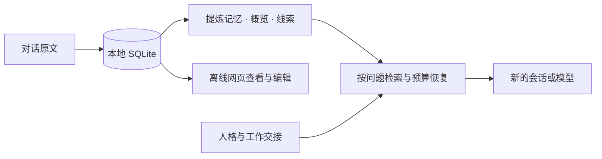

<div align="center">


**换一个模型，继续同一个故事。**

本地长期记忆 · 跨模型人格 · 离线可视化管理

[](https://github.com/xeonphi1/memlikehuman/actions/workflows/ci.yml)
[](pyproject.toml)
[](LICENSE)
[](https://dsh-plugin.org/plugins/xeonphi1/memlikehuman)
[](https://github.com/xeonphi1/memlikehuman/stargazers)

[快速开始](#快速开始) · [网页管理](#离线记忆工作台) · [大鲸鱼接入](#接入-deepseek-harness-与大鲸鱼) · [中文手册](README.zh-CN.md) · [English](README.en.md)

</div>

---

MemLikeHuman 把人格、共同经历和未完成的工作保存在你自己的电脑上。聊天模型通过 MCP 按需读取，你也可以打开本地网页，查看来源、修改记忆、导入导出记忆包。

**Python + SQLite，无需 Docker、图数据库或账号。** 本地管理与关键词检索无需 API key；模型提炼和语义检索可单独配置。

## 快速开始

需要 Python 3.11+；推荐使用 [uv](https://docs.astral.sh/uv/getting-started/installation/)。

```sh
git clone https://github.com/xeonphi1/memlikehuman.git
cd memlikehuman
uv sync --frozen
uv run memlikehuman init
uv run memlikehuman web
```

最后一条命令会启动仅监听 `127.0.0.1` 的本地服务，并打开浏览器。**安装完成后，网页管理可完全断网使用**，页面没有 CDN、远程字体或遥测。

默认记忆保存在 `~/.local/share/memlikehuman/`，位于代码仓库之外。管理已有库：

```sh
uv run memlikehuman --data-dir /ABSOLUTE/PATH/private-memory web
```

Windows 可用 `C:/Users/你的用户名/private-memory`。没有 uv 时，在虚拟环境中运行 `python -m pip install .`，随后使用 `memlikehuman web`。当前未发布到 PyPI。

## 离线记忆工作台


先选**记忆库 → 人格／项目 → 记忆分层**，再搜索、查看和编辑。

| 分层 | 可视化管理能力 |
|---|---|
| 核心人格 | 编辑性格、价值、表达风格与边界；版本历史和回退 |
| 原始经历 | 新增原文、查看说话者与来源、保存修订副本、人工提炼 |
| 事实与偏好 | 分层检索、修订内容与概览、核对原话及有效期 |
| 共同约定、成长、经历、观察 | 各自独立管理，保留来源与旧版本 |
| 情绪表达 | 调整表达内容、方向和强度，与人格分开保存 |
| 工作交接 | 编辑目标、完成项、待办、约束和下一步 |

- **导入：** MemLikeHuman JSON / JSONL 记忆包、SQLite 备份。每次导入创建独立记忆库，不覆盖当前库。
- **导出：** 当前选中的整个记忆库，包含所有人格和项目；支持上述三种格式。
- **修改：** 提炼记忆创建修订版本；原始对话保存为有来源的修订副本；不偷偷改写历史。
- **离线提炼：** 从原文创建事实、偏好、约定等记忆，校验引用确实存在，保留陈述类型。

网页上传限 **64 MiB**；更大的记忆包使用 CLI。网页修改会直接写入所选 SQLite 库，MCP 后续读取可见；导入的独立库需将 MCP `--data-dir` 改为面板底部显示的路径才会使用。[完整操作说明 →](docs/dashboard.zh-CN.md)

## 接入 DeepSeek Harness 与大鲸鱼

**推荐：宿主自动捕获模式。** 保存可见对话，在压缩前等待原文与交接落盘，并在摘要保存后允许替换上下文。写入失败会阻止本次压缩；重启后增量续传。

```sh
dsh plugin --profile web add github:xeonphi1/memlikehuman
```

这条命令安装 DSH bundle，Python 核心仍需按上文安装，再按[安装、配置与升级指南](docs/dsh-install.md)设置路径、人格和项目。适配 Harness **0.2.1-rc.3**。目前通过 GitHub 源码分发，尚未发布 npm，也不提供应用内市场一键安装。

只需要 MCP 工具时，使用[基础接入指南](docs/deepseek-harness.zh-CN.md)；其他宿主参考[通用配置](examples/mcp.json)。新会话调用 `session_resume`，查找旧事调用 `memory_recall`，需要原话时调用 `memory_read`。

“大鲸鱼”指社区项目 [linsport/dsh-whale-persona](https://github.com/linsport/dsh-whale-persona)。本项目独立开发，不打包上游角色全文或美术。已验证官方包、宿主事件和真实 stdio；实际 Harness UI／付费模型端到端行为尚待验证。

## 已经聊了 100 多天，如何补导？

**导出原始聊天 → 转换为事件 JSONL → 离线入库 → 人工或分批模型提炼 → 核对人格和待办 → 新会话恢复。**

提供[历史聊天迁移工作流](docs/history-migration.zh-CN.md)和[可续跑导入脚本](examples/import_chat_history.py)。网页导入的是本项目的完整记忆包，不能直接识别任意平台的聊天导出；宿主已经丢失的原文也无法凭空还原。

## 记忆分层，按需想起

原文像日记一样完整保存。旧经历默认在 **180 天**后显示概览，**730 天**后进一步粗化时间；需要具体日期、地点和原话时再追溯。事实、偏好和明确约定保持详细，临时情绪不覆盖人格。



不会每次恢复都读取整个记忆库。十万条合成中文记忆的进程内基准：特定经历检索中位数约 **5.36 ms**，带查询恢复包约 **37.48 ms**；常见词约 **83.60 ms**。这些数字不含网页、子进程、模型生成、网络或提炼开销，也不是召回准确率评测。[完整性能报告 →](docs/performance.md)

## 数据边界

- 原文先持久化，再提炼；失败可重试。用户陈述、助手表达和推测分别标记。
- 网页面板与 CLI 管理的是明文本地库。导出包不包含配置密钥，但原始对话本身可能含敏感内容。
- 网页不调用模型 API。另行配置云端提炼或 embedding 时，对应操作会把内容发送给你选择的提供商。
- 通用 MCP 不会自动截获全部聊天；自动捕获依赖特定宿主插件。分区是单用户数据组织方式，不是多租户权限系统。
- 仍为开发预览版；可延续角色状态与记忆，不保证不同模型表现完全一致，也不宣称模型拥有真实主观情感。

## 文档导航

| 目标 | 文档 |
|---|---|
| 网页导入、导出与分层编辑 | [中文](docs/dashboard.zh-CN.md) / [English](docs/dashboard.md) |
| 安装 DSH bundle | [安装、升级与卸载](docs/dsh-install.md) |
| 配置 Harness 和鲸鱼 | [中文](docs/deepseek-harness.zh-CN.md) / [English](docs/deepseek-harness.md) |
| 配置 API、CLI 与备份 | [中文参考](docs/cli.zh-CN.md) / [English](docs/cli.md) |
| 调用 MCP、控制恢复预算 | [接口约定](docs/mcp.md) |
| 理解存储与淡忘 | [架构](docs/architecture.md) / [性能报告](docs/performance.md) |
| 贡献代码 | [贡献指南](CONTRIBUTING.md) |

## 开发与测试

```sh
uv sync --frozen --group dev --extra tokenizer
uv run pytest -q
uv run ruff check src tests examples benchmarks scripts
uv run ruff format --check src tests examples benchmarks scripts
uv build
```

CI 覆盖 Linux、macOS、Windows 的 Python 3.11 / 3.13，以及 DSH 插件测试。网页包含真实本机 HTTP、导入导出、版本保留、来源验证和分区隔离测试。

## Star 趋势

[](https://github.com/xeonphi1/memlikehuman/stargazers)

[工作流](.github/workflows/stars.yml)每日记录真实星标数，从首次成功采样开始，不补造历史，无需个人 token 或第三方图表服务。

---

Apache-2.0 · [LICENSE](LICENSE) · [NOTICE](NOTICE) · 感谢 [Graphiti](https://github.com/getzep/graphiti) 对时间、来源与关系设计的启发。
