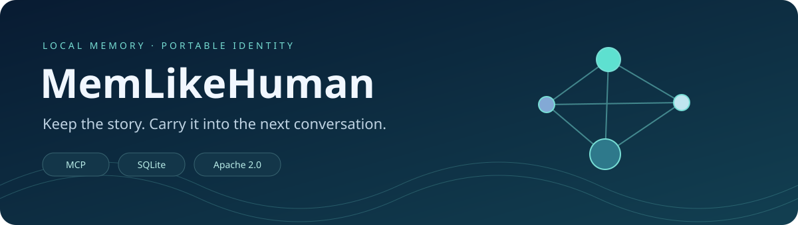
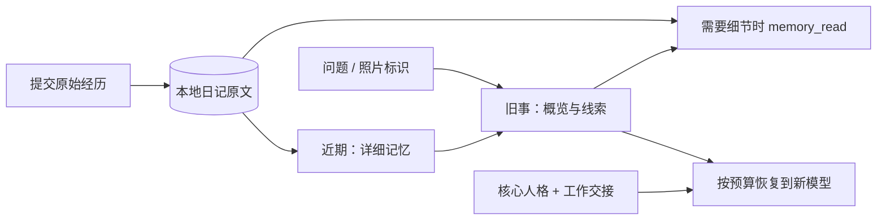
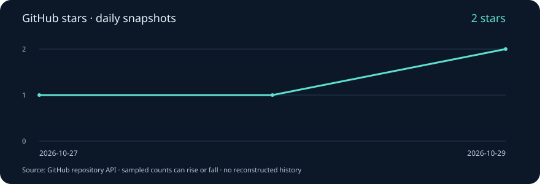

<div align="center">



**换一个模型，继续同一个故事。**

将人格、共同经历和未完成的工作保存在本地，按需带入下一次对话。

[](https://github.com/xeonphi1/memlikehuman/actions/workflows/ci.yml)
[](pyproject.toml)
[](LICENSE)
[](https://github.com/xeonphi1/memlikehuman/stargazers)

[快速开始](#快速开始) · [大鲸鱼接入](docs/deepseek-harness.zh-CN.md) · [性能实测](docs/performance.md) · [完整中文手册](README.zh-CN.md) · [English](README.en.md)

</div>

---

**DSH 插件安装：[完整安装、升级与卸载指南](docs/dsh-install.md)**（记忆与上下文类；Python 核心需单独安装）。

源码安装：`dsh plugin --profile web add github:xeonphi1/memlikehuman`。当前仅使用 GitHub 源码分发，申请 DSH 网站收录；尚未发布 npm，不提供应用内市场一键安装。

**新增：[Harness 自动捕获与压缩前交接](docs/host-capture.zh-CN.md)** — 指定预设的可见文本自动落盘，写入失败时阻止压缩，重启增量续传。

## 它记住什么？

MemLikeHuman 是一个 **Python + SQLite 的本地 MCP 记忆服务**。模型负责对话，记忆属于你。

| 保存的内容 | 恢复时的行为 |
|---|---|
| **核心人格** | 稳定、版本化；由用户编辑，可回退 |
| **共同经历** | 近期细节清楚，旧事逐渐只呈现概览；原文始终可查 |
| **事实与偏好** | 保留来源、确认程度和变化历史；不把推测当事实 |
| **共同约定与成长** | 有出处、可解释、可撤销，不自动覆盖核心人格 |
| **情绪表达** | 随时间回归基线，不把一时情绪写成人格 |
| **未完成的工作** | 恢复目标、已完成事项、约束、待办和下一步 |

不需要图数据库或 Docker。未配置 API 时，原文持久化、中文关键词检索、手动提炼和恢复都可离线使用。提炼模型、embedding 模型与聊天模型分别配置。

> **v0.2 开发预览版。** 通用 MCP 只能保存宿主主动提交的内容，不能自行捕获全部聊天或检测上下文即将满。它提供可迁移的角色状态和记忆，不宣称让模型获得真实主观情感，也不保证不同模型表现完全一致。

## 快速开始

需要 Python 3.11+ 和 [uv](https://docs.astral.sh/uv/getting-started/installation/)。

```sh
git clone https://github.com/xeonphi1/memlikehuman.git
cd memlikehuman
uv sync --frozen
uv run memlikehuman init
uv run memlikehuman doctor
```

默认真实数据保存在 `~/.local/share/memlikehuman/`，位于仓库之外。用 `--data-dir` 或 `MEMLIKEHUMAN_HOME` 修改目录。Windows 同样可用；没有 uv 时，在 Python 虚拟环境中执行 `python -m pip install .`。当前未发布到 PyPI。

**先体验一次离线跨会话恢复：**

```sh
uv run python examples/demo.py --data-dir /tmp/memlikehuman-demo
uv run memlikehuman --data-dir /tmp/memlikehuman-demo --project synthetic-demo resume --budget 16000
```

演示只使用合成中文记录，不调用付费 API：搬家前后的城市、共同约定、未确认的偏好，以及上次没完成的工作。Windows 请把 `/tmp/memlikehuman-demo` 换成新的本地目录。

## 已经聊了 100 多天，怎么补导旧记忆？

按[历史聊天迁移工作流](docs/history-migration.zh-CN.md)操作：导出原始聊天 → 转换为逐条事件 JSONL → 离线校验入库 → 分批提炼 → 核对人格与待办 → 新会话恢复。提供[可续跑的导入示例](examples/import_chat_history.py)，不会调用模型 API。当前仍需按实际平台格式做转换，不是任意平台导出的一键导入器。

## 给 DeepSeek Harness 的大鲸鱼接上记忆

**自动捕获模式（推荐）**：按 [DSH bundle 安装指南](docs/dsh-install.md)安装，自动记录可见文本并在压缩前保存交接；检索和新会话恢复仍使用 MCP。此模式保护所选预设的默认压缩器摘要入口，升级数据库至 v3，已有用户请先备份。

**基础 MCP 模式**：以下步骤适合仅使用工具、由模型主动提交记忆的用户。不要同时启用两套逐条记录约定。

已准备 [一步一步的中文指南](docs/deepseek-harness.zh-CN.md)、[Cordis 配置](examples/deepseek-harness.cordis.yml) 和[会话调用约定](examples/whale-host-instructions.txt)。

1. 安装本服务，初始化 `whale` 人格与私人数据目录。
2. 修改示例中的两个绝对路径，将 `insert` 块合并到 Harness 用户补丁。
3. 重启并新建鲸鱼会话，确认 `mcp__memlikehuman__…` 工具已出现。
4. 每次明确使用相同的 `persona_id` 和 `project_id`：先恢复，再记录，需要原话时翻日记。

这里的“大鲸鱼”指 [linsport/dsh-whale-persona](https://github.com/linsport/dsh-whale-persona)。已按 Harness 上游文档与源码核对配置，并测试本服务的真实 stdio 通信；真实 Harness UI 与付费模型的端到端行为仍需验证。指南还说明了 API key 转发、与 `dsh-mnemon` 共存及新会话验收方法。

其他 MCP 客户端参考 [通用配置](examples/mcp.json) 与 [接口约定](docs/mcp.md)。

## 像日记一样保留，像回忆一样调用



默认在 180 天后将旧经历呈现为概览，730 天后进一步粗化时间标签。阈值可配置；这是工程上的记忆呈现策略，不是对人脑的生物学模拟。事实、偏好和明确约定保持详细，日记原文不会被摘要覆盖。

例如，平常只带入“曾一起放过风筝”；问到具体日期、地点和原话，再读对应的原始事件。没有经过提炼的概览只标为“主题线索”，不会编造故事补全空白。

```sh
uv run memlikehuman recall '蓝色风筝'
uv run memlikehuman recall '蓝色风筝' --detail detailed
uv run memlikehuman read RECORD_ID
uv run memlikehuman recall '' --cue-key 'photo:sha256:YOUR_IMAGE_HASH'
```

照片功能目前是**已登记的标识／描述触发检索**：通过 `memory_record.cues` 关联经历，不存储图片，也不自行识别照片。详见[淡忘与性能设计](docs/performance.md)。

## 记忆多了，会不会变慢？

恢复不会把整个记忆库塞进上下文，也不会每次换模型都重新总结历史。默认 `fast` 走本地索引，先取有限候选，再按预算组装。

本机合成中文基准，7 次查询的中位数：

| 记忆量 | 特定经历检索 · 优化前 → 后 | 恢复包 · 优化前 → 后 |
|---:|---:|---:|
| 1,000 | 3.54 → **1.09 ms** | 9.91 → **3.26 ms** |
| 10,000 | 28.36 → **1.50 ms** | 78.76 → **7.22 ms** |
| 100,000 | 288.22 → **5.36 ms** | 804.97 → **37.48 ms** |

这是**本地进程内记忆服务延迟**，不含模型生成、网络、提炼 API 或 MCP 启动。十万条中搜索常见词“朋友”约 83.60 ms；首次中文分词加载也有额外成本。没有把这些数字当作聊天总延迟承诺。完整环境、原始数据、限制与复现命令见[性能报告](docs/performance.md)。

## 数据可控，记忆有出处

- 原文先提交 SQLite 事务，再尝试提炼；API 失败保留 `pending`，稳定事件 ID 防重复。
- 每条提炼记忆关联来源；用户陈述、助手表达和推测分别标记。
- 按人格与项目隔离；“以前住上海，现在住杭州”可分别查询当前和历史。
- 支持人格版本回退、纠错、删除、JSON/JSONL 导入导出和 SQLite 备份恢复。
- 不保存配置密钥到导出包。真实对话本身可能包含敏感信息，应由你管理。

本地数据为明文；配置云端提炼或语义检索时，相应内容会发送给所选提供商。项目面向可信的单用户 stdio 客户端，分区不是多租户权限系统。详见[架构与行为边界](docs/architecture.md)。

## 文档导航

| 想做什么 | 从这里开始 |
|---|---|
| 配置大鲸鱼和 Harness | [中文接入指南](docs/deepseek-harness.zh-CN.md) / [English](docs/deepseek-harness.md) |
| 管理人格、API、备份和纠错 | [完整中文手册](README.zh-CN.md) / [English manual](README.en.md) |
| 调用工具、控制上下文预算 | [MCP 接口与宿主约定](docs/mcp.md) |
| 理解淡忘、原文追溯与延迟 | [性能与记忆分层](docs/performance.md) |
| 理解存储、迁移与可靠性 | [架构说明](docs/architecture.md) |
| 贡献代码或复现测试 | [贡献指南](CONTRIBUTING.md) |

## Star 趋势

[](https://github.com/xeonphi1/memlikehuman/stargazers)

由 [Star trend 工作流](.github/workflows/stars.yml)每天记录 GitHub 返回的实际星标总数。曲线从首次成功采样开始，不补造此前历史；取消 Star 也会使数量下降。新仓库在首次运行前显示等待采样。无需个人 token 或第三方图表服务；如果仓库限制 Actions 写权限，可以手动运行脚本更新。

## 参与开发

```sh
uv sync --frozen --group dev --extra tokenizer
uv run pytest -q
uv run ruff check src tests examples benchmarks scripts
uv run ruff format --check src tests examples benchmarks scripts
uv build
```

测试包含真实 MCP 子进程、进程中断、幂等写入、事实变化、淡忘与日记追溯、照片线索、分区、迁移与备份。CI 覆盖 Linux、macOS、Windows 的 Python 3.11 / 3.13；跨真实模型的效果验证另见 [eval_models.py](examples/eval_models.py)。

欢迎提交带复现步骤的 Issue 和有针对性的 PR。已提供 [Harness 自动捕获／压缩交接插件](docs/host-capture.zh-CN.md)。下一步重点是更多宿主适配、更大规模语义索引及真实模型评测。

Apache-2.0 · [LICENSE](LICENSE) · [NOTICE](NOTICE)

感谢 [Graphiti](https://github.com/getzep/graphiti) 对时间、来源与关系设计的启发。本实现不依赖或复制 Graphiti，也未打包上游鲸鱼角色内容。
[](https://dsh-plugin.org/plugins/xeonphi1/memlikehuman)
