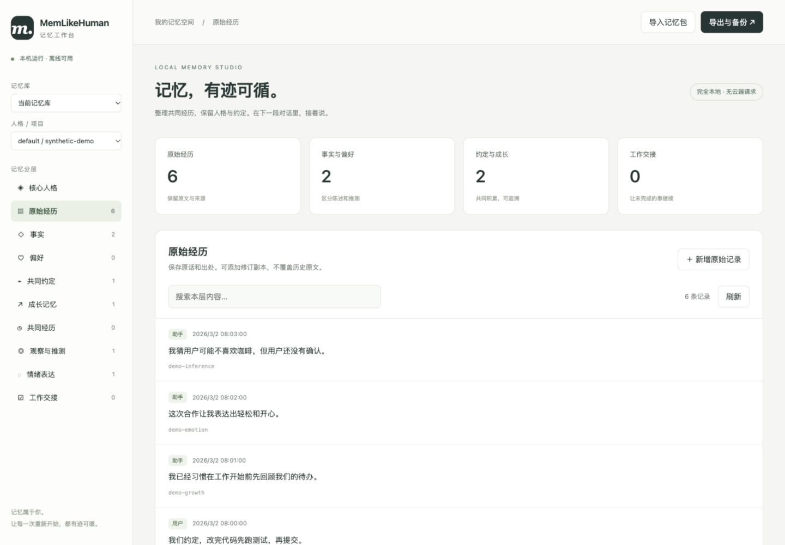

# MemLikeHuman · 中文使用指南

**把记忆留在本地，让不同模型继续同一段对话与工作。**

[项目首页](README.md) · [English](README.en.md) · [网页操作手册](docs/dashboard.zh-CN.md) · [CLI 详细参考](docs/cli.zh-CN.md)

## 1. 安装与打开面板

```sh
git clone https://github.com/xeonphi1/memlikehuman.git
cd memlikehuman
uv sync --frozen
uv run memlikehuman init
uv run memlikehuman web
```

需要 Python 3.11+ 和 uv；或在虚拟环境中运行 `python -m pip install .`。安装依赖需要联网，安装完成后的网页管理不需要网络、账号或 API key。默认数据目录为 `~/.local/share/memlikehuman/`，不要把真实记忆放进开源仓库。

指定已有数据目录：

```sh
uv run memlikehuman --data-dir /ABSOLUTE/PATH/private-memory web
```

网页仅监听 `127.0.0.1`。默认自动打开带临时访问凭据的链接；`web --no-browser` 只打印链接，`web --port 8765` 指定端口。服务停止后网页不再读写，数据仍保留在磁盘。

## 2. 选择记忆层并编辑



左侧依次选择记忆库、人格／项目和记忆层。列表每页 20 条，按当前层搜索；点击记录打开详情。

| 分层 | 操作 | 保存规则 |
|---|---|---|
| 核心人格 | 名称、性格、价值、表达、边界；版本回退 | 新增版本；同一人格在不同项目间共享 |
| 原始经历 | 新增、查看来源、保存修订副本、人工提炼 | 原文不覆盖；修订副本标为参考资料 |
| 事实、偏好、约定、成长、经历、观察 | 内容、概览、置信度 | 新版本保留原来源和陈述类型，旧版本可追溯 |
| 情绪表达 | 内容、方向、强度、概览 | 独立于人格，仍按原有时间衰减 |
| 工作交接 | 目标、完成、待办、约束、下一步 | 新增交接；覆盖位置必须属于同一分区与会话 |

人工提炼入口在原始记录详情内。来源原话必须确实存在；助手文本不能被标成用户已确认陈述。保存后原文标记为已人工处理，后续如需补充仍可继续人工提炼。

编辑提炼记忆会使当前分区旧工作交接失效，防止旧摘要继续传播错误；请核对后重建。删除使用现有级联语义，会删除来源事件、同来源派生记忆及纠错链；独立副本和已有备份不受影响。操作前可先导出。

## 3. 导入、导出与文件边界

点击“导入记忆包”，支持本项目的 **JSON、JSONL 和 SQLite 备份**。导入会创建独立库，验证失败不会覆盖当前库。单文件上限 64 MiB；大文件用 CLI 导入空目录。

“导出与备份”导出选中记忆库的**全部人格和项目**，不只是当前层。JSON / JSONL 省略可重建索引及配置密钥；SQLite 备份包含数据库快照。导出包中已有的私人对话不会自动脱敏。

导入库位于主目录下的 `dashboard-libraries/<id>/`。想让 MCP 使用整理后的导入库，将其 `--data-dir` 改为网页底部显示的路径并重启。已有 MCP 指向当前库时，网页保存后即可被后续读取。

> 任意平台聊天导出 ≠ MemLikeHuman 记忆包。已有 100 天聊天请先走[历史迁移流程](docs/history-migration.zh-CN.md)，再在网页管理。网页不自动解析 DeepSeek／ChatGPT／Claude 的平台格式。

## 4. 接入大鲸鱼

Python 核心安装后，推荐 DSH bundle：

```sh
dsh plugin --profile web add github:xeonphi1/memlikehuman
```

按[安装指南](docs/dsh-install.md)继续配置路径、人格和项目。支持 Harness 0.2.1-rc.3，GitHub 源码分发，尚未发布 npm。自动捕获可见消息并在压缩前后保存交接；恢复和检索仍通过 MCP。

其他客户端使用[基础 MCP 指南](docs/deepseek-harness.zh-CN.md)和[通用配置](examples/mcp.json)。通用 MCP 不能强制模型写入全部对话。

## 5. 淡忘、性能与隐私

原始日记完整保留；旧经历默认 180 天后显示概览、730 天后进一步粗化时间。事实、偏好和约定保持详细。恢复按预算读取有限候选，不把全部记忆塞进上下文。[性能与限制](docs/performance.md)

网页的所有资源都在本地，不触发提炼、embedding 或远程请求。命令行提炼、语义检索是否联网，取决于你另行配置的提供商。本地库未加密；面板面向可信的单用户电脑，不应通过反向代理公开到网络。

## 更多操作

- [完整 CLI、API 配置、人格、备份与恢复参考](docs/cli.zh-CN.md)
- [网页使用与故障排查](docs/dashboard.zh-CN.md)
- [MCP 工具与预算约定](docs/mcp.md)
- [架构与可靠性](docs/architecture.md)
- [宿主自动捕获细节](docs/host-capture.zh-CN.md)

开发预览版。跨模型延续的是可追溯的角色状态和记忆，不代表真实主观情感，也不保证模型输出完全一致。Apache-2.0；原始人格示例中性原创，不分发鲸鱼角色全文或美术。
