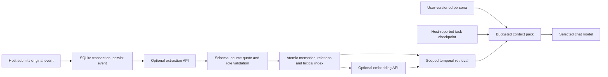

# Architecture and behavioral contract

## Data flow

The model is replaceable. SQLite is the authority. Indexes and context packs are derived. This design borrows temporal validity and provenance concepts from Graphiti; it does not implement a graph engine or import Graphiti code.

## Authority, attribution and scope

- `personas`: immutable versions, keyed by persona ID + version. Reading an absent persona initializes the neutral default. Rollback appends a new version rather than erasing history. MCP exposes read-only persona access; changes use the local CLI.
- `events`: original submitted text, host-asserted role, source, category, session, occurrence time, ingestion time and sequence. Event IDs are unique across the database. A duplicate ID must have the same payload/scope; an omitted timestamp reuses the original occurrence time.
- `memories`: derived text, exact quote, source event, kind, basis, confidence, subject/fact key, validity interval, revocation state and optional expressed emotion. Confidence is model-supplied ranking metadata, not calibrated probability.
- `relations`: explicit `related` links within a scope; `corrects` links preserve correction lineage. Shared event IDs also expose provenance through `memory_read`.
- `checkpoints`: host-reported goal, completed/pending steps, constraints, next action and last covered event sequence. Coverage must refer to the same scope/session. It does not independently verify that work happened.
- `embeddings` and `search`: rebuildable vector cache and Chinese-tokenized SQLite FTS5 index.

All event/memory/task operations require persona + project scope; defaults are explicit. Persona versions span their own projects. Clients are trusted local processes: a client can request other scope IDs. These partitions are not security boundaries for multi-tenant hosting.

Reference material and persona text are archived but not extracted as lived experience. A user-statement basis requires a user event; assistant expressions require an assistant event. Inferences cannot acquire single-valued fact keys or become learned growth. Role emotion must come from an assistant expression. An exact quote is necessary but cannot prove entailment; the extracting model can still misunderstand questions, negation or identity. Review/correction remains important.

## Temporal facts, correction and forgetting

For single-valued facts, `subject + fact_key` identifies the changing property. Only user-stated facts/preferences participate. Occurrence/validity time is distinct from database creation time. Unknown validity starts at the source event's occurrence time. Intervals are half-open: `valid_at <= query_time < invalid_at`. All public times require a timezone and normalize to UTC.

New facts close earlier intervals. Late historical inserts are ordered by validity time. Equal start times use insertion time and ID as a deterministic tie-break. Expired facts remain queryable through `as_of`/`include_history`; future facts are excluded until their start. Existing closed intervals are not reopened when successor evidence is deleted. Source/validity histories are retained, but this version does not provide full transaction-time “what the system knew on day X” querying.

A correction creates a new explicit-correction event, revokes the mistaken memory, preserves an audit relation and marks the old raw event as amended. Omitted `valid_at` retains the mistaken memory's start. This is intended for correcting an error, not representing a new change. New current facts should be submitted as events.

Permanent deletion starts from an event or memory. It removes the source event, all memories co-derived from that event and the connected correction lineage in both directions. Search entries, vectors and relation edges are removed transactionally. Unrelated memories connected only by `related` survive. Correction/deletion invalidate all checkpoints in the affected scope, because arbitrary task prose cannot be reliably scrubbed. Already emitted packs, independent copies, backups and remote API logs are not modified.

Ordinary forgetting combines presentation fading with ranking decay: freshness uses a 180-day configurable half-life. It never deletes sources. Episodes, observations and emotions older than 180 days surface a short gist; after 730 days the time label is coarsened to a decade. These are configurable engineering defaults, not biological claims. Authored gists are generated during extraction; older records without them use explicitly labeled extractive topic cues. Stable facts, preferences, agreements and growth remain detailed. Original source text, exact timestamps and quotes remain available through memory_read. Photo/text cues are indexed identifiers and labels, not image recognition or image storage. The most recent expressed role emotion has valence/arousal decayed toward zero with a configurable 6-hour default half-life. It does not change the core persona. Historical emotion expressions remain source records; expressions whose decay factor is below 0.01 are omitted from current emotional state.

## Retrieval and budget

Chinese `jieba` search-mode tokens feed FTS5. Individual CJK characters are additionally indexed so a query like `书` matches compounds such as `本书`. Queries are escaped as FTS literals, not executable query syntax. Retrieval combines lexical rank, optional cosine similarity (threshold 0.3), one-hop explicit related links, source basis, confidence and freshness. Fast recall selects bounded candidates through FTS, source-event keys and one-hop relation indexes. It never loads all memory text and never calls an embedding API. Explicit semantic mode linearly scans up to the configured number of recent eligible vectors (default 2,000), with a coverage warning; deep mode scans all eligible vectors. Common lexical terms can still require more FTS work as archives grow. A query with no evidence returns no memory; it does not substitute unrelated recent facts.

Raw conversation events without derived memories are searchable as a labeled fallback, capped at 2000 characters with an explicit truncation flag. `memory_read` pages original evidence (4000 characters by default) without altering stored text. Raw text from amended or already-derived events is not used to resurrect revoked/expired facts. Recent event excerpts in a restore pack are chronological context with occurrence timestamps, not an authoritative current-fact list.

Embedding fingerprints include endpoint, model and configured version. New automatic extractions are indexed opportunistically. `reindex` builds all vectors outside a database transaction and replaces the scope's index only after success. Manual derivation, corrections, imports and model/version changes need reindexing; queries warn when index coverage is incomplete. Vector failures never roll back saved original text or memories. Current memory presence/content is rechecked before vectors are committed.

`session_resume` returns a JSON-encoded context string. Whole components are added in order: persona, checkpoint, up to 20 recent agreements/growth records, up to 20 recalled memories, current emotion, up to 5 recent conversation events. A component that does not fit is omitted and identified in response metadata. More source material remains accessible with `memory_read`/`memory_recall`.

Persona + framing that cannot fit returns an empty context and `insufficient_budget`. The host should increase the budget or explicitly edit the persona. Known optional tokenizers count only context text. Unknown models use UTF-8 byte length as a deliberately conservative estimate; this is not a universal tokenizer guarantee. Metadata and MCP/host overhead are outside this budget.

## Durability and operations

Python 3.11+, official MCP SDK 1.x maintenance line constrained to `<2`, Pydantic, httpx and jieba. Exact dependency versions are in `uv.lock`. SQLite uses WAL, foreign keys, busy timeout and immediate write transactions. The schema version is `PRAGMA user_version`; installation applies migrations 0→1→2; version 2 adds gists, cue keys and lookup indexes. Version 1 JSON/JSONL and SQLite backups remain importable. Newer schema versions are refused. Future incompatible changes must add explicit migrations, not silently recreate tables.

The original event transaction commits before network work. Extraction failure leaves it pending with a sanitized error. Validation of an extraction batch and all derived inserts share one transaction. Duplicate completion returns existing IDs. There is no hidden daemon; pending work resumes via `retry` or re-submitting the same event. A killed process cannot lose an acknowledged database commit, subject to normal filesystem/storage guarantees.

Exports read a consistent SQLite snapshot. JSON/JSONL archives contain all authoritative tables and format version, excluding configuration and vector/index caches. Import requires an empty destination and validates shape, timestamps, quotes, roles, scope links and checkpoint coverage before committing. Backups use SQLite's backup API, not a copy of the main file without its WAL. Existing target files are never overwritten. Restoring a SQLite backup also passes through archive validation and index rebuilding.

`doctor` checks integrity, foreign keys, table counts and pending extractions. CLI validation errors omit input values; provider errors omit remote response bodies/credentials. There is no telemetry. Data is plaintext at rest. File/directory permissions protect it where supported; deletion is a logical database operation, not a claim of forensic erasure from SSDs or external snapshots.

## Limitations and next steps

No chat interception, pre-compaction hook, background reminders, autonomous core-persona editing, universal model adapter, graph database, encryption-at-rest layer or hosted multi-user authentication is included. An extraction model must support the configured OpenAI-compatible JSON-object API. The endpoint/model remains an operator choice; no paid calls run during tests. Distinct models' behavior and naturalness require the optional two-model probe plus human assessment.

Later host adapters should submit trusted original events and call checkpoint/resume at lifecycle boundaries. A future Graphiti backend can reuse the normalized evidence/export model, but must demonstrate better recall on the same scenarios before introducing deployment overhead.
