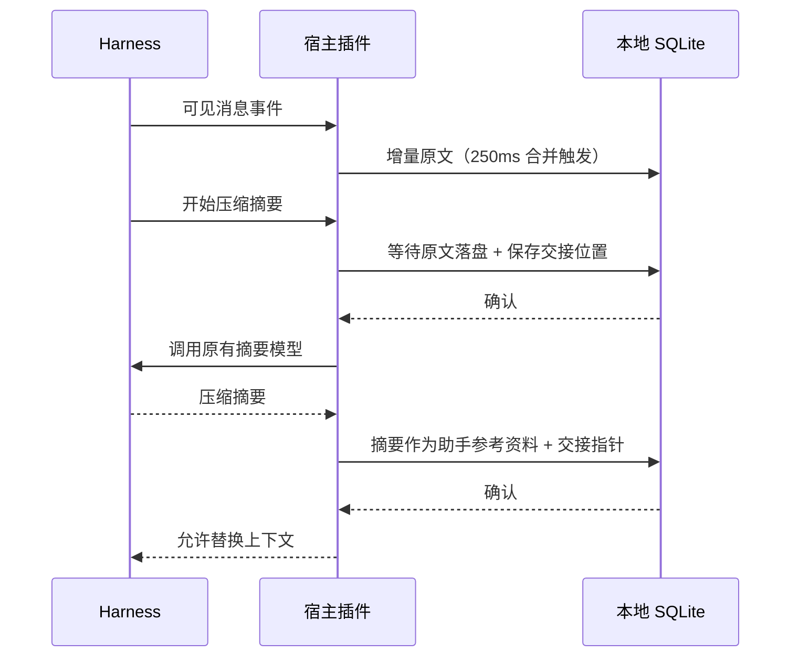

# DeepSeek Harness 自动捕获与压缩交接

此插件将选定预设的可见用户文本和助手回复自动存入 MemLikeHuman，压缩前等待本地写入，摘要生成后再次保存交接，然后才允许宿主替换上下文。无需模型主动调用 `memory_record`，捕获过程不调用提炼 API。人格编辑、检索、恢复仍使用原有 CLI / MCP。

## 安装

适配 **DeepSeek Harness 0.2.1-rc.3** 的 `session/event`、`session/flush` 和 `BasicCompactionEngine.summarize`。依赖锁文件固定官方包；不保证其他版本兼容。对照源码版本为 `22ddee3792402c3e70ec5f86a63c3e3e895a2f60`。Node.js 22+、Python 3.11+。

1. 在仓库根目录更新 Python 安装：`uv sync --frozen`。先通过原有 `backup` 命令备份记忆库。本次数据库升级到 v3，旧程序不能再打开新库。
2. 安装宿主插件依赖：

   ```sh
   cd integrations/deepseek-harness
   npm ci --ignore-scripts
   ```

3. 将 [自动捕获配置](../examples/deepseek-harness-auto.cordis.yml) 合并到 `~/.dsh/profiles/web/cordis.patch.yml`（桌面版使用 `desktop`；自定义 `DSH_HOME` 时以其目录为准）。替换所有绝对路径。Windows 的命令路径为 `.venv/Scripts/memlikehuman.exe`。
4. 该补丁**替换**现有 `compaction-basic` 行，不是并行加载另一套压缩器。若原来调整过压缩阈值或摘要模型，将原配置完整移到 `config.compaction`。保留鲸鱼预设及原 MCP 配置。
5. 保持 `dataDir`、`persona`、`project` 与 MCP 调用一致；`preset: whale` 只捕获鲸鱼会话，排除子代理。每套独立 Harness 安装使用不同且稳定的 `instanceId`。
6. **重启 Harness**，进入鲸鱼会话。旧会话首次打开时，会从宿主仍保留的日志补录可见文本；已有读取位置时只读取增量。宿主已经删除的原文无法重建。

安装此插件后，调整原来的宿主指令：不要再逐条用 `memory_record` 记录同样的对话；新会话仍调用 `session_resume(persona_id="whale", project_id="companionship")`，不指定旧 session。需要旧事时调用 `memory_recall` / `memory_read`。人格并未因启用插件而被修改。

## 保存了什么

- 仅 `source.kind=user` 的用户文本，以及最终/中断时已组装的助手可见文本；保留宿主事件时间、角色和可追溯事件序号。
- 每个文本块分片保留原文；记录 ID 由分区、宿主实例、会话和事件位置生成，重试不会重复产生记录。
- 不把系统提示词、隐藏推理、工具参数或宿主注入的 user-role 摘要误记为用户说过的话。本版不复制图片/音频二进制，也不采集工具结果；附件仍需单独保存或作为线索手动提交。
- 在本地 SQLite 中保存读取位置；JSON/JSONL 导出及 SQLite 备份包含该位置。删除记忆后重启，不会因为回放原日志而自动恢复旧记录。另换 `instanceId` 或重新导入原始日志属于一次新的导入，可能产生副本。
- 原文状态为 `pending`，可以立即通过原文检索读取。需要事实/偏好/概览时，另外运行 `retry --limit 20` 等提炼命令；本插件不在聊天关键路径上调用云端提炼或 embedding。

## 压缩时序与失败行为



自动压力压缩、上下文溢出重试、手动 `/compact` 和区域压缩，都经过原压缩器的摘要入口。写入超时、磁盘故障、桥接失败时抛错，本次压缩不进入上下文替换。修复后重试即可。普通消息监听器失败时显示警告，已提交宿主日志不会因此消失；下一次 flush / 重启从已确认位置重试。

首次接入很长历史可能需要较长补录时间。每次最多扫描 50 个宿主事件，不随每一轮重复扫描全库。它有 Python 子进程启动与 SQLite 写入开销，**不能套用 README 中纯检索的毫秒基准**。宿主日志在本插件确认前也尚未持久化、且进程遭强杀的极小窗口，仍依赖 Harness 自身的日志恢复；本插件不能承诺零丢失。

压缩前若已有结构化任务状态，会保留它；没有时保存“待确认当前任务”的原文指针，不猜测任务完成情况。摘要保存为 assistant/reference，交接指向摘要记录，并标注应核对原文。摘要覆盖宿主选定的压缩区间，不保证概括所有保留尾部。原结构化交接历史仍在导出包中。总结失败但原文已保存，不会回滚原文。

## 验收与排错

1. 用合成对话说“我以前住上海，现在住杭州；下一步整理照片”。等待该轮结束。
2. 使用相同数据目录执行 `memlikehuman --data-dir /PRIVATE/memory --persona whale --project companionship recall 杭州`，应能找到原文；不需要先运行提炼 API。
3. 正常重启 Harness，继续一条新消息，再查原文，应只有一次原始记录。
4. 手动 `/compact`（宿主需要有足够可压缩历史），通过 `resume` 查看交接，按其 ID 用 `read` 阅读助手摘要。
5. 在测试数据目录中故意配置不存在的桥接命令，执行压缩应报错；恢复命令后可重试。不要使用自己的唯一记忆库做破坏性试验。
6. 换模型、新建鲸鱼会话，通过 MCP `session_resume` 读取同一份记忆，再验证来源及下一步。

自动化测试覆盖真实 Python 子进程与 SQLite、官方 npm Session 消息格式、官方 BasicCompactionEngine 摘要方法、失败阻止压缩、重启增量、跨预设隔离、删除与导出恢复游标。尚未运行实际 Harness UI / 付费模型端到端测试。

适配器目前使用官方仍提供的 `snapshotEvents(from, to)` 范围读取接口；上游将其标记为 deprecated。升级 Harness 前运行插件测试并检查接口，不要无验证地修改依赖版本。

## 开发验证

```sh
# 仓库根目录
uv run pytest -q
# 插件目录（先 npm ci）
MLH_COMMAND=/ABSOLUTE/PATH/memlikehuman/.venv/bin/memlikehuman npm test
```

参考：[官方会话事件接口](https://github.com/deepseek-ai/deepseek-harness/blob/22ddee3792402c3e70ec5f86a63c3e3e895a2f60/packages/core/session/src/index.ts)、[官方压缩器扩展点](https://github.com/deepseek-ai/deepseek-harness/blob/22ddee3792402c3e70ec5f86a63c3e3e895a2f60/packages/compaction/compaction-basic/src/index.ts)。
